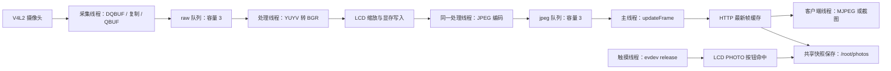

# i.MX6ULL 摄像头与 LCD 视频流工程文档

## 快速编译、部署与运行

在工程根目录执行 ARM 编译：

```sh
cd /home/hxh1987370733/workspace/cam
make -B -f Makefile.arm cam_server_arm
file build_arm/cam_server_arm
```

将产物复制到板卡并启动。`BOARD_IP` 替换为板卡地址；程序默认使用 `/dev/input/event1`：

```sh
scp build_arm/cam_server_arm root@BOARD_IP:/opt/cam/
ssh root@BOARD_IP
cd /opt/cam
chmod +x cam_server_arm
mkdir -p /root/photos
LD_LIBRARY_PATH=/opt/cam/lib ./cam_server_arm \
  --device /dev/video1 --fb /dev/fb0 --touch /dev/input/event1 \
  --snapshot-dir /root/photos
```

触摸并释放圆形按钮时，应依次看到 `[Touch] Release ...`、`[Touch] Photo button activated ...` 和 `[Touch] Photo saved: /root/photos/snapshot_....jpg`；使用 `ls -lh /root/photos` 检查文件。

本工程在 i.MX6ULL Linux 板卡上采集 YUYV 视频，同时输出到 LCD 和浏览器，并支持截图保存与下载。目标 LCD 为 1280x640；程序以 framebuffer 驱动报告的实际模式为准。

## 1. 文件功能描述

### 1.1 工程目录

```text
cam/
├── AGENTS.md                 开发约定
├── cam.md                    技术文档
├── Makefile                  Linux 本机构建
├── Makefile.arm              Buildroot ARM 交叉编译
├── include/                  模块接口和数据结构
├── src/                      应用入口与模块实现
│   └── touchscreen.cpp       Linux evdev 触摸读取
├── tests/                    独立 C++ 回归测试
├── build/                    本机编译产物（构建时生成）
├── build_arm/                ARM 编译产物（构建时生成）
└── /root/photos/             板端默认照片目录（首次拍照时生成）
```

| 文件 | 职责与关键接口 |
| --- | --- |
| [src/main.cpp](src/main.cpp) | 解析启动参数；启动 LCD、摄像头和 HTTP；通过 `captureLoop`、`encodeLoop`、主线程发布 JPEG；协调异常及信号退出。 |
| [src/v4l2.cpp](src/v4l2.cpp)、[include/v4l2.hpp](include/v4l2.hpp) | `V4l2Capture` 封装格式协商、MMAP 缓冲区、`poll` 取帧和资源释放。 |
| [src/jpeg_encoder.cpp](src/jpeg_encoder.cpp)、[include/jpeg_encoder.hpp](include/jpeg_encoder.hpp) | `convertToBgr` 转换 YUYV，`encodeBgr` 压缩 JPEG；`encode` 保留直接编码 YUYV 的接口。 |
| [src/framebuffer.cpp](src/framebuffer.cpp)、[include/framebuffer.hpp](include/framebuffer.hpp) | `FramebufferDisplay` 管理设备和显存；`FramebufferSurface` 校验内存布局并绘制，可绑定测试内存。 |
| [src/touchscreen.cpp](src/touchscreen.cpp)、[include/touchscreen.hpp](include/touchscreen.hpp) | 读取 Linux evdev 触摸释放事件，自动识别带触摸按键和绝对 X/Y 轴的 `/dev/input/event*`，归一化到 LCD 坐标。 |
| [src/http_server.cpp](src/http_server.cpp)、[include/http_server.hpp](include/http_server.hpp) | `HttpServer` 提供网页、MJPEG 和截图，维护最新 JPEG、客户端数量和截图配额。页面 HTML/CSS/JavaScript 内嵌在源文件中。 |
| [include/frame.hpp](include/frame.hpp) | `Frame` 保存数据、序号、尺寸、行跨度和单调时钟时间戳。 |
| [include/bounded_queue.hpp](include/bounded_queue.hpp) | `BoundedQueue<T>` 提供线程安全的 `push`、阻塞 `take` 和 `close`。 |
| [tests/video_test.cpp](tests/video_test.cpp) | 校验显示像素、黑边、偏移、显存保护区、YUYV 行跨度、JPEG 和队列。 |
| [tests/v4l2_test.cpp](tests/v4l2_test.cpp) | 通过 GNU 链接器 `--wrap` 模拟系统调用，验证驱动协商、坏帧处理及失败清理。 |
| [tests/http_server_test.cpp](tests/http_server_test.cpp) | 通过本机 TCP 验证路由、截图内容、配额、非法请求、断开连接及重启。 |
| [Makefile](Makefile)、[Makefile.arm](Makefile.arm) | 设置 C++14、编译依赖、输出目录和测试目标；头文件变更会触发重新构建。 |

仓库包含用户态应用，不包含设备树、摄像头驱动、LCD 驱动或板级根文件系统。

## 2. 实现方式与收益

### 2.1 数据流与线程分工



LCD 关闭时，处理线程直接将 BGR 编码为 JPEG。HTTP 另有一个接收连接的线程，每个已接纳客户端使用独立处理线程。

两个队列满时丢最旧帧，不让内存随积压无限增长。HTTP 客户端读取最新 JPEG，慢客户端可以跳过中间帧。容量限制不能保证固定延迟；LCD 和 JPEG 在同一线程串行执行，编码耗时仍会影响显示帧率。

当 LCD 初始化成功时，显示层在右下角绘制小型圆形白色快门按钮：白色内圆、窄黑色间隙和白色外环。触摸线程默认打开 `/dev/input/event1`；也可以用 `--touch PATH` 指定其他 evdev 设备。设备只要具备触摸按键（`BTN_TOUCH`/`BTN_LEFT`）或多点触摸跟踪 ID（`ABS_MT_TRACKING_ID`），并提供绝对 X/Y 轴即可接受。触摸按下后在圆形按钮内释放，才触发一次拍照。原始触摸范围通过 `EVIOCGABS` 读取，再线性映射到 framebuffer 可见分辨率。

触摸拍照和 HTTP `/snapshot` 共用同一个 JPEG 快照保存函数，因此命名、配额、目录创建、写盘锁和错误结果一致。默认目录为 `/root/photos`；目录不可写、尚无首帧或达到张数配额时，触摸线程只记录错误，不会写入空文件。圆形按钮只绘制到 LCD 显存，不会混入 JPEG 或网页视频。

### 2.2 采集格式、缓冲区与数据有效性

打开设备后，依次执行 `QUERYCAP`、`S_FMT`、`REQBUFS`、`QUERYBUF`、`mmap`、`QBUF` 和 `STREAMON`。默认申请 4 个驱动缓冲区，实际使用驱动返回的数量。设备提供 `V4L2_CAP_DEVICE_CAPS` 时按 `device_caps` 判断当前节点能力。

只接受单平面 `V4L2_BUF_TYPE_VIDEO_CAPTURE`、YUYV 和逐行扫描。驱动可调整请求的宽高；后续处理使用协商后的尺寸及行跨度。YUYV 的两个像素按 `Y0 U Y1 V` 排列，因此宽度必须为偶数。

MMAP 将驱动缓冲区映射到用户空间；应用仍会复制一份帧数据，再立即归还缓冲区，供驱动继续采集。这样可让工作线程持有独立数据，属于映射采集加一次用户态复制，并非全流程零拷贝。

`getFrame` 默认等待 250 ms，区分完整帧、超时和错误。超时或信号中断允许循环继续；坏帧及短帧归还驱动后丢弃；非法下标、越界数据和设备错误终止流水线。没有“连续超时自动退出”或摄像头自动重连。

帧有效长度按以下公式检查，末行无需包含尾部填充：

```text
最小字节数 = (height - 1) * bytes_per_line + width * 2
```

### 2.3 BGR 复用与 LCD 输出

OpenCV 使用 `CV_8UC2` 和实际步长读取 YUYV，通过 `COLOR_YUV2BGR_YUYV` 转为 `CV_8UC3`。每帧只转换一次；LCD 使用转换结果，JPEG 编码也使用该结果。

显示模块读取 `FBIOGET_FSCREENINFO`、`FBIOGET_VSCREENINFO` 并映射 `smem_len`。像素地址包含可见窗口偏移和驱动行跨度：

```text
offset = (yoffset + y) * line_length + (xoffset + x) * (bits_per_pixel / 8)
```

按颜色位域打包像素，并预计算 256 项颜色表。支持小端平台上 16/24/32 位 packed pixels 真彩色，包括常见 RGB565、RGB888、XRGB8888；有透明度位域时写入全不透明值。通道必须互不重叠、每通道不超过 8 位且无 msb_right；调色板、DIRECTCOLOR、灰度、非标准、旋转及 YWRAP 模式被拒绝。

最近邻缩放降低处理开销，放大边缘会较粗糙。画面等比例居中，不拉伸、不裁剪。640x480 视频在 1280x640 面板上显示为 853x640，左右黑边分别为 213 和 214 像素。首次显示及输入尺寸变化时清理可见区域；不覆盖行填充或其他虚拟页面。

程序使用驱动现有显示模式，不设置 LCD 时序、背光、垂直同步或翻页。退出时解除映射，不主动清屏或恢复先前画面。

### 2.4 模块接口与所有权

| 接口或数据 | 使用约定 |
| --- | --- |
| `Frame::data` | raw 队列保存 YUYV；jpeg 队列保存 JPEG。编码帧的 `bytes_per_line` 不用于 JPEG 解码。 |
| `Frame::timestamp_us` | 复制完成后的单调时钟时间，不是驱动曝光时间或日历时间；当前不对外发送。 |
| `V4l2Capture` | 持有设备句柄与映射，禁止复制；`stop` 同时关闭设备，重新采集需再次 `open`。类接口默认设备为 `/dev/video0`，应用参数默认值为 `/dev/video1`。 |
| `JpegEncoder::convertToBgr` | 返回内部复用缓存的引用；下一次转换可能覆盖数据，应在同一处理线程内消费。调用者负责保证输入缓冲区长度足够。 |
| `FramebufferSurface::configure` | 借用内存而不持有所有权；在 `reset` 前必须保持内存有效，并保持显示模式不变。 |
| `BoundedQueue::close` | 拒绝后续入队并唤醒消费者；队列接口可排空已有数据，但应用退出时可能丢弃待处理原始帧。队列不能重新打开。 |
| `HttpServer::updateFrame` | 复制非空 JPEG 并递增内部序号，客户端发送时不持有帧锁。 |
| `HttpServer::captureSnapshot` | 供触摸线程调用的本地快照入口；复用 `/snapshot` 的保存逻辑和 `SnapshotResult`。 |
| `Touchscreen::waitForTap` | 只在触摸释放时返回归一化坐标；超时返回 false。 |

### 2.5 HTTP、截图与资源限制

HTTP 监听所有 IPv4 接口，支持 GET 和 HTTP/1.0、HTTP/1.1 请求行。查询参数不影响端点匹配。MJPEG 使用 `multipart/x-mixed-replace; boundary=frame`，每个分段包含 JPEG 长度。

| 项目 | 当前设置 |
| --- | --- |
| 同时接纳客户端 | 默认 8 个，网页、视频流、截图和未完成请求均占用名额 |
| 请求头上限 | 8192 字节 |
| socket 接收/发送超时 | 每次接收约 5 秒、每次发送约 2 秒；不是整条请求的绝对时限 |
| 最新帧缓存 | 1 张 JPEG；每个发送客户端另有自己的帧副本 |
| 截图配额 | 默认 100 张，按目录中 `snapshot_*.jpg` 命名匹配项计数；不是磁盘字节配额 |
| 截图文件名 | `snapshot_YYYYMMDD_HHMMSS_微秒_递增序号.jpg`，触摸和 HTTP 使用同一命名，时间使用系统本地时区 |

截图先保存到板端，再返回同一份 JPEG 下载。触摸拍照只保存文件，不发送 HTTP 响应。配额检查与写文件串行执行；不会自动删除旧截图。默认 `/root/photos` 的父目录 `/root` 已存在；自定义路径的父目录须预先存在。截图写入成功不等于执行过 `fsync`，异常断电后的持久性仍取决于文件系统。

截图配额和客户端上限通过 `HttpServer` 构造参数设置，当前没有对应命令行选项。服务没有认证、TLS 或访问授权；应在可控网络运行，公网部署需另外配置访问控制。

### 2.6 退出行为与当前限制

Ctrl-C/SIGINT 和 SIGTERM 设置退出标志；采集与编码线程关闭队列，主线程等待工作线程，再关闭 HTTP 客户端和采集设备。正常退出返回 0；参数、初始化、采集或处理故障返回 1。退出耗时受当前处理帧、驱动 ioctl 和客户端操作影响，不承诺固定时限。

目前不支持 MJPEG-only、UYVY、多平面采集、音频、录像、帧率参数、硬件编码、LCD 双缓冲或自动重连。JPEG 使用 CPU 编码；单页面显存写入可能出现撕裂。摄像头色彩范围和矩阵按当前 OpenCV 转换路径处理，没有根据 V4L2 色彩元数据动态选择。触摸线程不执行自动校准，若触摸面板旋转方向与 framebuffer 不一致，需要在 BSP 或驱动层修正。

## 3. 学习指南

### 3.1 建议学习顺序

| 阶段 | 重点概念 | 对应源码与练习 |
| --- | --- | --- |
| 1. 数据与生命周期 | C++14、vector、move、RAII、析构、禁止复制 | 阅读 `Frame`、`V4l2Capture::stop` 和 `FramebufferDisplay::close`，画出资源持有关系。 |
| 2. V4L2 | 字符设备、ioctl、MMAP、缓冲区队列、非阻塞 I/O、poll | 阅读 `open/start/getFrame`，运行 `make test_v4l2`，跟踪短帧和映射失败路径。 |
| 3. 图像处理 | YUYV 4:2:2、BGR、步长、JPEG 有损压缩 | 阅读编码模块，运行 `make test_video`，说明为何奇数宽度非法、末行填充可省略。 |
| 4. LCD | framebuffer、RGB 位域、小端字节序、可见/虚拟分辨率 | 阅读显示模块，用地址公式计算带偏移与填充的像素位置，理解黑边测试。 |
| 5. 触摸输入 | evdev、`input_event`、`EVIOCGBIT`、`EVIOCGABS`、绝对坐标归一化 | 阅读 `Touchscreen::openCandidate/waitForTap`，用 `evtest` 核对触摸按键和轴范围。 |
| 6. 并发 | mutex、condition_variable、atomic、信号安全、线程 join | 阅读队列和主流程，追踪采集故障如何让主线程结束等待。 |
| 7. 网络与板端 | TCP 短写、HTTP multipart、SIGPIPE、交叉编译、动态链接 | 阅读 `writeAll/serveStream/stop`，对照 SDK sysroot 和目标动态库部署应用。 |

### 3.2 关键知识点

- 区分图像宽度、每行字节数和整帧有效长度；`width * height * 2` 不能覆盖所有带填充的 YUYV 帧。
- 区分用户态 MMAP 虚拟地址与物理显存地址，不能把 `smem_start` 直接当作普通指针写入。
- 区分关闭队列、停止线程和释放设备。信号处理器只设置标志，锁、日志和资源释放在正常流程执行。
- 区分单调时钟帧时间戳与系统本地时间截图命名。板卡未校时会影响文件名日期。
- 区分目标 ARM 库与本机 x86 库；OpenCV、libstdc++、C 库、浮点 ABI 和动态加载器须与板端系统兼容。

### 3.3 Function comment convention

Follow the root `AGENTS.md` rule for every function and important callback. Use English Doxygen block comments with `@brief`, parameter directions, return values, and optional notes or warnings:

```cpp
/**
 * @brief  Wait for and copy one complete YUYV frame.
 * @param  [out] out Owned copy of the captured payload.
 * @param  [in] timeoutMs Poll timeout in milliseconds.
 * @retval Frame A complete frame is available.
 * @retval Timeout No frame is ready or a corrupt frame was discarded.
 * @retval Error The device returned invalid data or failed.
 */
```

Interface comments describe ownership, cache reuse, exceptions, and output validity where relevant. Implementation comments describe the operation without repeating each source line. This update converted function comments in headers, sources, and tests from Chinese `功能` blocks to the required English Doxygen format.

Validation: all 147 function comment blocks use English `@brief` descriptions. The application and all three test executables rebuilt successfully with `-Wall -Wextra`. Preprocessed output for the existing nine C++ source/test files remained identical during the previous comment-only correction; the new touchscreen implementation is covered by the current application build. Video and simulated V4L2 tests were rerun after this feature update; real touchscreen and LCD behavior still require board testing.

## 4. 工程使用说明、编译命令与预期效果

### 4.1 运行前提

| 环境 | 必要条件 |
| --- | --- |
| Linux 开发机 | 支持 C++14 的 g++、GNU make、pkg-config；构建主程序和视频测试需 OpenCV 4 开发头文件及库 |
| ARM 构建机 | 板卡 Buildroot SDK、匹配 sysroot 的交叉编译器、ARM OpenCV 安装目录 |
| 板端摄像头 | 可读写的 video 节点，支持单平面逐行 YUYV 和 MMAP streaming |
| 板端 LCD | 正确配置的 LCDIF/面板时序及背光，可读写的 framebuffer 真彩色节点 |
| 板端触摸屏 | 可读的 evdev 事件节点，提供 `BTN_TOUCH`/`BTN_LEFT` 与绝对 X/Y 轴 |
| 板端存储与网络 | 可写截图目录、足够剩余空间、可达的 HTTP 端口和匹配动态库 |

LCD 的 1280x640 分辨率、像素时钟、同步极性和引脚配置由板卡 BSP/设备树完成。触摸设备节点和坐标轴范围由触摸驱动注册。避免 fbcon、图形服务或其他进程同时写同一显存；程序运行中不要更改 framebuffer 模式。

### 4.2 Linux 本机构建与测试

在仓库根目录执行：

```sh
pkg-config --modversion opencv4
make cam_server
./build/cam_server --help
make test_video
make test_v4l2
make test_http_server
```

| 命令 | 结果或前提 |
| --- | --- |
| `make` / `make cam_server` | 生成 `build/cam_server`，启用 `-std=c++14 -Wall -Wextra -O2 -g` |
| `make run` | 构建后按默认设备和参数运行；没有摄像头时无法启动 |
| `make test_video` | 运行无硬件视频测试；成功输出 `Video pipeline tests passed` |
| `make test_v4l2` | 运行模拟驱动测试；成功输出 `V4L2 capture tests passed`，故障注入日志属于预期输出 |
| `make test_http_server` | 运行本地 TCP 集成测试，不需要摄像头或 OpenCV；环境必须允许创建/绑定 socket |
| `make test` | 汇总三组测试；默认串行执行时前一组失败会阻止后续组执行 |
| `make clean` | 删除本机构建目录 `build/`，保留截图和 ARM 构建产物 |

测试使用独立 C++ 可执行文件和断言辅助函数，不依赖第三方测试框架。无硬件环境可分别运行视频和 V4L2 测试。修改代码后按模块选择测试；纯文档修改核对参数、链接和命令即可。

### 4.3 ARM 交叉编译与部署

本机 100ask Buildroot SDK 位于 `$HOME/toolchain/100ask_imx6ull-sdk/ToolChain/arm-buildroot-linux-gnueabihf_sdk-buildroot`。`Makefile.arm` 默认使用该 SDK 的编译器，并将 OpenCV 前缀设为 `$HOME/opencv_arm_buildroot_install`。SDK sysroot 应与板端 glibc、libstdc++ 和浮点 ABI 匹配；不要回退到 WSL Ubuntu 自带的 ARM 编译器。其他位置的 SDK 可通过 `BUILDROOT_SDK=...` 覆盖。

```sh
SDK="$HOME/toolchain/100ask_imx6ull-sdk/ToolChain/arm-buildroot-linux-gnueabihf_sdk-buildroot"
"$SDK/bin/arm-buildroot-linux-gnueabihf-g++" -dumpmachine
"$SDK/bin/arm-buildroot-linux-gnueabihf-g++" -print-sysroot
```

OpenCV 源码在 `~/workspace/opencv_src/opencv` 时，可使用同一 Buildroot SDK 构建动态库：

```sh
cmake -S "$HOME/workspace/opencv_src/opencv" \
  -B "$HOME/workspace/opencv_src/build-arm-100ask" \
  -DCMAKE_TOOLCHAIN_FILE="$SDK/share/buildroot/toolchainfile.cmake" \
  -DCMAKE_INSTALL_PREFIX="$HOME/opencv_arm_buildroot_install" \
  -DBUILD_LIST=core,imgproc,imgcodecs -DBUILD_SHARED_LIBS=ON \
  -DBUILD_TESTS=OFF -DBUILD_PERF_TESTS=OFF -DBUILD_EXAMPLES=OFF -DWITH_JPEG=ON
cmake --build "$HOME/workspace/opencv_src/build-arm-100ask" --parallel 2
cmake --install "$HOME/workspace/opencv_src/build-arm-100ask"
make -f Makefile.arm cam_server_arm
file build_arm/cam_server_arm
```

该 ARM 规则已在 `Makefile.arm` 内固定使用工程上级的 `../../toolchain/100ask_imx6ull-sdk/ToolChain/arm-buildroot-linux-gnueabihf_sdk-buildroot` 和 `../../opencv_arm_buildroot_install`，因此不需要在命令行重复传入路径；路径以 Makefile 所在目录计算，从其他工作目录调用也有效。命令链接 `opencv_core`、`opencv_imgproc`、`opencv_imgcodecs` 和 pthread；OpenCV 必须启用 JPEG 编码支持。额外动态库依赖由目标 OpenCV 的构建配置决定。需要独立输出目录时可追加 `OBJ_DIR=build_arm_100ask`；构建应用与 OpenCV 时应使用同一个 SDK，避免引入比板端更新的 GLIBC/GLIBCXX 符号版本。

把 `build_arm/cam_server_arm` 和匹配的运行库部署至板卡。例如将程序放到 `/opt/cam/`、私有动态库放到 `/opt/cam/lib/` 后，在板端执行：

```sh
cd /opt/cam
chmod +x ./cam_server_arm
mkdir -p /root/photos
LD_LIBRARY_PATH=/opt/cam/lib ./cam_server_arm --device /dev/video1 --fb /dev/fb0 --snapshot-dir /root/photos
```

自定义库路径示例应包含全部依赖；若库已安装在系统标准搜索路径，可省略 `LD_LIBRARY_PATH`。切换 SDK 或 OpenCV 安装路径后，先执行 `make -f Makefile.arm clean` 再构建，避免沿用旧二进制。两个构建文件的 clean 分别删除各自输出目录。

### 4.4 启动参数与常用模式

| 参数 | 默认值 | 约束与行为 |
| --- | --- | --- |
| `--device PATH` | `/dev/video1` | 摄像头设备路径，设备不存在或不支持时退出 |
| `--width N` | 640 | 请求宽度，2..8192 且必须为偶数；以驱动实际协商值为准 |
| `--height N` | 480 | 请求高度，1..8192；以驱动实际协商值为准 |
| `--fb PATH` | 未显式指定 | 默认尝试 `/dev/fb0`；显式传入该参数则要求 LCD 必须初始化成功 |
| `--no-lcd` | 未启用 | 禁用 LCD，与 `--fb` 互斥 |
| `--port N` | 8080 | HTTP 监听端口，1..65535；端口占用或无权限时退出 |
| `--quality N` | 80 | JPEG 质量，1..100；不是帧率参数 |
| `--snapshot-dir PATH` | `/root/photos` | 触摸和 HTTP 图片保存目录；父目录须已存在且可写 |
| `--touch PATH` | `/dev/input/event1` | 指定触摸 evdev 节点；设备打开失败会退出 |
| `--no-touch` | 未启用 | 禁用 LCD 拍照按钮和触摸线程 |
| `--help` | 未启用 | 显示帮助并退出，不打开设备 |

LCD 与网络同时输出：

```sh
./cam_server_arm --device /dev/video1 --fb /dev/fb0 --touch /dev/input/event1 --width 640 --height 480 --port 8080 --quality 80
```

仅网络输出：

```sh
./cam_server_arm --device /dev/video1 --no-lcd --no-touch --port 8080
```

直接运行 `./cam_server_arm` 会尝试可选 LCD 和 `/dev/input/event1` 触摸设备；失败时分别打印提示并继续 HTTP/摄像头功能。显式 `--fb /dev/fb0` 或 `--touch PATH` 失败则返回 1。正常停机使用 Ctrl-C，后台进程可用 `kill -TERM <PID>`。

### 4.5 预期日志、画面与 HTTP 接口

成功启动日志示例，实际设备名称和位深可能不同：

```text
[LCD] /dev/fb0 1280x640 16 bpp, stride=2560
[LCD] PHOTO button x=1176 y=536 w=80 h=80
[V4L2] 驱动: <driver> 设备: <card>
[V4L2] 分辨率为640x480 YUYV
[V4L2] 采集已启动
[HTTP] Server listening on port 8080
[Touch] Opened /dev/input/event1 range=0..4095,0..4095 mode=touch-key
```

LCD 显示居中视频和黑边；网页显示同一视频源经 JPEG 压缩后的画面，两者更新时间不保证同步。JPEG 和截图保留摄像头实际分辨率，不采用 LCD 缩放尺寸。

LCD 打开后会立即在右下角显示小型圆形白色快门按钮，按钮坐标同时输出为 `[LCD] PHOTO button x=... y=... w=... h=...`。1280x640 面板的默认几何为 `x=1176 y=536 w=80 h=80`；1024x600 面板为 `x=920 y=496 w=80 h=80`。触摸释放时会先打印 `[Touch] Release raw=... screen=...`，命中后打印 `[Touch] Photo button activated ...; capturing latest JPEG`，成功则输出 `[Touch] Photo saved: /root/photos/snapshot_....jpg`。触摸其他区域会输出 `Tap outside photo button`；没有首帧时输出 `no camera frame is available`。网页截图仍返回并保存到同一目录。

浏览器访问 `http://板卡IPv4地址:8080/`。以下是接口约定：

| 请求 | 成功响应 | 操作与典型失败 |
| --- | --- | --- |
| `GET /` | 200，HTML 页面 | 页面打开 `/stream` 长连接并提供截图按钮 |
| `GET /stream` | 200，multipart MJPEG | 没有首帧时连接等待；只发送新序号，不持续重复旧帧 |
| `GET /snapshot` | 200，JPEG 下载 | 同时保存到板端；无帧 503、配额满 507、目录或写盘错误 500 |
| 其他路径 | 404 | 查询字符串会先移除，如 `/snapshot?time=...` 仍为截图端点 |
| 非 GET / 非法请求 | 405 / 400 / 431 | 分别表示方法不支持、请求行非法和请求头超限 |

连接名额用尽返回 503。一个浏览器访问首页通常会发起多条请求，不应把默认 8 个连接理解为 8 个完整浏览器会话。

在另一台可访问板卡的机器上验证（将地址替换为板卡实际地址）：

```sh
curl -i http://192.168.1.100:8080/
curl -D snapshot.headers -o snapshot.jpg http://192.168.1.100:8080/snapshot
curl --max-time 3 -o stream.mjpeg http://192.168.1.100:8080/stream
```

确认截图响应为 200 且类型为 `image/jpeg` 后再打开 `snapshot.jpg`；失败响应也会被 curl 保存。视频请求达到示例中的 3 秒时限后超时退出属于预期行为。

### 4.6 故障排查

| 现象或日志 | 排查步骤 |
| --- | --- |
| `opencv4` pkg-config 找不到 | 确认本机 OpenCV 开发文件和 `opencv4.pc` 已安装；自定义安装时配置 `PKG_CONFIG_PATH` |
| 交叉编译器不存在 | 检查 `BUILDROOT_SDK` 路径和 SDK 的 `bin/arm-buildroot-linux-gnueabihf-g++`；不要用本机 g++ 或不匹配的 Ubuntu ARM 工具链编译板端产物 |
| 找不到 OpenCV 头文件或库 | 检查 `OPENCV_ARM` 是否指向 ARM OpenCV 安装前缀，确认其中有 `include/opencv4/` 和 `lib/`，并确认库与编译器 ABI 匹配 |
| 板端 `Exec format error` | 用 `file` 检查是否误部署了 `build/cam_server`，同时核对目标架构 |
| 程序存在却报告 `not found` / 缺少共享库 | 核对动态加载器、浮点 ABI、C 库和 OpenCV；板端如有 `ldd` 可检查依赖 |
| 摄像头无法打开 / 不支持 YUYV | 检查 `ls -l /dev/video*`、设备权限和占用；如有 v4l2-ctl，执行 `v4l2-ctl -d /dev/video1 --list-formats-ext` |
| 持续短帧或坏帧日志 | 检查驱动协商结果、USB/摄像头链路和内核日志；当前会丢帧，不会自动修复驱动 |
| LCD 无法打开 / 模式不支持 | 检查 `ls -l /dev/fb*`；如有 fbset，执行 `fbset -fb /dev/fb0 -i`；核对位深、真彩色位域和 BSP |
| LCD 黑屏、文字覆盖或撕裂 | 核对背光、面板时序、fbcon 和其他显存写入者；撕裂可能来自当前单页面刷新方式 |
| LCD 无 `PHOTO` 按钮或无触摸日志 | 先确认运行的是重新编译并复制到板端的 ARM 二进制：`strings ./cam_server_arm | grep 'PHOTO button'` 应能找到按钮日志文本。启动日志必须出现 `[LCD] PHOTO button x=...`；例如 1024x600 LCD 应为 `x=920 y=496 w=80 h=80`。如果只有 `[LCD] ... 1024x600 ...` 而没有该行，说明板端仍运行旧二进制，需停止旧进程、重新复制并重启。确认 `[Touch] Opened /dev/input/event1 ...` 后，按键释放应出现 `[Touch] Release raw=... screen=...`；没有该日志时检查 event1 权限和 `evtest` 能否看到事件。出现 `Tap outside photo button` 时检查触摸坐标映射；必要时用 `--touch PATH` 指定其他节点 |
| 触摸坐标总是变成屏幕右下角 | 某些 BSP 同时上报旧的 `ABS_X/ABS_Y` 和真实的 `ABS_MT_POSITION_X/Y` 范围；程序优先使用多点触摸轴。确认 `[Touch] Opened ... range=...` 与实际触摸原始值一致，并重新部署最新 ARM 二进制 |
| 触摸原始值超过设备声明范围 | 某些 BSP 仍会声明 `0..800,0..480`，但实际发送 `1024x600` 坐标；程序会打印 `raw value exceeds advertised max` 并按 LCD 尺寸自动校正。确认校正后 `screen=...` 坐标落在圆形按钮内 |
| 触摸位置偏移或上下颠倒 | 对照 `EVIOCGABS` 范围和 framebuffer 分辨率，检查 BSP 旋转/坐标变换；程序只做线性归一化，不做旋转校准 |
| HTTP 绑定失败 / 网页无法访问 | 查看端口是否占用，核对板卡 IP、同网段连通性和防火墙；启动成功日志不代表外部网络可达 |
| 截图 503 / 507 / 500 | 依次检查是否已采集首帧、是否达到 100 张、目录父路径/权限/磁盘空间；`df -h` 可查看存储 |
| 触摸按钮点击但没有文件 | 先确认出现 `[Touch] Photo button activated`；再检查首帧是否已生成、`/root/photos` 权限和磁盘空间；查看 `[Touch] Photo ignored/rejected/failed` 日志 |
| 帧率偏低 | 比较 `--no-lcd` 模式，检查 CPU 和网络；降低采集尺寸或 JPEG 质量做实测，程序没有 FPS 设定选项 |
| HTTP 测试 `Operation not permitted` | 环境禁止创建 socket；转到允许本地 TCP 的环境运行，不能计为测试通过 |

诊断命令依赖板端工具是否安装。不要直接修改像素时钟、清空截图或解除控制台绑定来替代定位问题。

### 4.7 测试证据与上板验收

本次加入触摸输入、LCD `PHOTO` 拍照按钮和共享照片保存入口；视频回归测试还验证了按钮立即绘制、按钮几何和命中区域。触摸线程新增释放坐标、命中判断、截取开始和保存结果日志，并兼容 `ABS_MT_TRACKING_ID` 触摸设备。执行 `make -B cam_server test_video test_v4l2 build/test_http_server` 后，主程序与三组测试均编译成功，视频测试和模拟 V4L2 测试运行通过；`./build/cam_server --help` 已确认显示 `/root/photos`、`--touch` 和 `--no-touch`。另外执行 `make -B -f Makefile.arm cam_server_arm` 已使用固定 SDK/OpenCV 路径生成 ARM ELF；触摸真实事件、LCD 显示和板端照片写入仍需上板验证。

HTTP 测试此前因当前环境禁止 socket 而无法运行，本次仅重新编译，没有取得新的 TCP 运行结果。当前环境没有摄像头和 LCD；ARM 构建已完成，真实显示、触摸输入、板端照片写入与长时间运行仍待上板验证。

| 上板验收项 | 预期结果 |
| --- | --- |
| 摄像头与 LCD 初始化 | 日志报告协商尺寸、LCD 实际模式和 HTTP 端口，无异常退出 |
| 色彩与比例 | 红绿蓝和黑白正常，画面不拉伸；640x480 到目标面板呈 853x640 居中显示 |
| 网页与截图 | 网页持续更新；截图响应为 JPEG，板端文件与下载内容一致 |
| 正常停机 | Ctrl-C/SIGTERM 可退出、进程结束后可重新打开设备；无需强制 SIGKILL |
| 设备故障 | 摄像头拔出并被驱动报告为错误时返回非零；只报告超时的驱动可能继续等待 |
| 长时间运行 | 记录板卡型号、BSP、摄像头、位深、参数、运行时长、CPU/内存、实际帧率和异常日志 |
| 多客户端与配额 | 慢客户端不长期占用帧锁；超过连接上限返回 503；截图配额满返回 507 |
| 触摸拍照 | 点击 LCD 圆形白色按钮生成一张 `/root/photos/snapshot_*.jpg`，重复点击产生不同递增序号；启动时可用 `[LCD] PHOTO button ...` 日志核对按钮几何位置 |

性能和稳定性数据需保留实测记录后再补充，当前没有固定帧率、延迟或持续运行时长的达标承诺。
